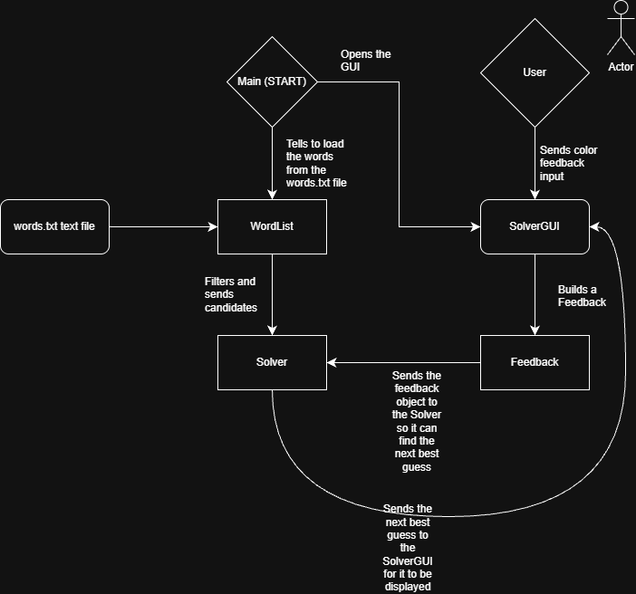
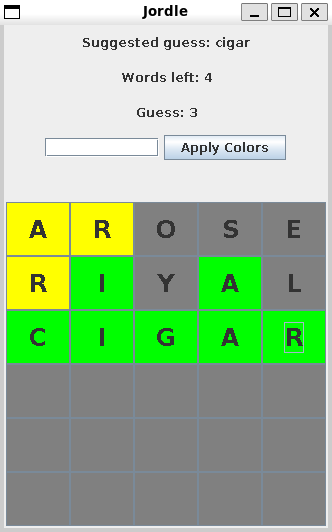

# Jordle

A Java Swing Wordle solver that filters possible answers from your guesses and suggests the next guess.

## The Problem

I lose track of which words still fit my earlier Wordle guesses, so I end up guessing randomly and losing my streaks. Jordle does that filtering for me and suggests the next guess.

## How It Works

Main loads a five-letter word list into a Solver and opens the window. You type a guess, click Submit, set each tile's color, and click Apply Colors. The Solver keeps only the words that match those colors and suggests the remaining word with the most common letters.

## Tech Stack

- Java (JDK 25)
- Java Swing and AWT for the GUI
- java.util and java.nio.file
- data/words.txt (public-domain ENABLE word list) for storage
- Git, GitHub, VS Code

## Setup

Install JDK 22 or newer, then run:

    git clone https://github.com/Puhalenthi/Jordle-Solver.git
    cd Jordle-Solver
    java src/Main.java

## Example

With the answer cigar: the first suggestion is arose. Entering arose with colors yellow, yellow, gray, gray, gray leaves 185 words and suggests riyal. Entering riyal with yellow, green, gray, green, gray leaves 4 words and suggests cigar.

## Roadmap

- [x] Load the word list
- [x] Filter words from guess colors
- [x] Letter-frequency suggestion
- [x] Swing window with tile grid and input
- [x] Input validation and end-of-game handling
- [ ] Pick guesses that eliminate about half of the remaining words
- [ ] Undo guesses

## Demo

[Video walkthrough](https://youtu.be/3zeQCeZAbis)